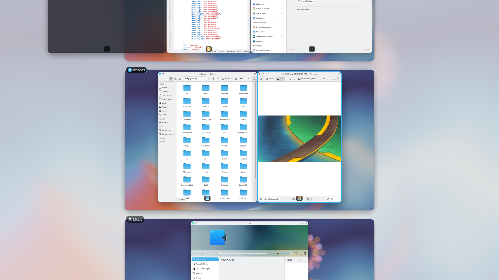

# Karousel Overview

[](https://github.com/divinae/karousel-overview/actions/workflows/ci.yml)
[](https://store.kde.org/p/2379855/)
[](https://github.com/divinae/karousel-overview/releases/latest)
[](#license)
[](https://ko-fi.com/divinae4535)

**All your desktops and every column, at once.** A [Niri](https://github.com/YaLTeR/niri)-style
overview effect for KWin, made for the [Karousel](https://github.com/peterfajdiga/karousel)
scrollable tiling script: all virtual desktops stacked vertically, each one a zoomed-out
horizontal strip of its windows, including the columns scrolled off-screen.



### Why you'll like it

- 🗺️ **The whole layout in view.** Every desktop as a strip, with the columns Karousel keeps off
  screen; pan a strip and Karousel's real view scrolls along, so you land where you looked.
- ✋ **Rearrange by dragging.** Move a window to another desktop, stack it onto another window,
  put it above or below in a column or give it a column of its own; move whole columns; drop it
  between desktops for a new one.
- 🔍 **Type to find.** Search the current desktop's windows, with KRunner's results, apps and
  more in the same panel.
- ⌨️ **Keys and gestures.** Meta+Ctrl+O, a screen edge or a touchpad swipe; arrow keys between
  windows and desktops, and Karousel's own key bindings keep working.
- 🧹 **Desktops that come and go.** Create, rename and remove desktops in place; optionally, as
  GNOME's dynamic workspaces, the ones made in the overview go again once they're empty.
- ✨ **Feels native.** The gaps are Karousel's, translucent windows get the blurred wallpaper
  behind them, and minimized ones wait dimmed at the end of their desktop.

It needs Karousel: it drives Karousel through its key bindings, and Karousel keeps off-screen
columns at their real positions, so the strips are rebuilt from window geometry.

<details>
<summary><b>Everything you can do in it</b></summary>

- Toggle with Meta+Ctrl+O, a screen edge (System Settings → Screen Edges) or a touchpad swipe up (enable in the effect's settings)
- Click a window to focus it, or click an empty part of a desktop to switch to it
- Drag a window to another desktop to move it there, or to the "New desktop" row to create one
- Drop a window onto another window: onto its middle to stack them (Karousel's stacked layout), onto its top or bottom to put it above or below in that column, onto its left or right quarter to give it a column of its own there; the part it drops onto is highlighted
- Hover a window and click the button next to ✕ to make it float, or tile it again (uses Karousel's "Toggle floating")
- Drag the grip on top of a column with several windows, or drop a window between columns, to move the whole column: onto another window all of its windows go where a single window would, it can also go to another desktop; the "Stack"/"Unstack" button in its top left corner switches the column between Karousel's stacked layout and the windows one under another
- Drop a floating window where it would be tiled to tile it there (uses Karousel's "Move column left/right" key bindings)
- Drag something from an app, e.g. a file, open the overview with its screen corner or shortcut and hold it over a window to switch to it and drop it there
- Panning the current desktop scrolls Karousel's real view column by column, so that you land where you scrolled
- Karousel's own key bindings work in the overview too, and the overview follows what they do
- Minimized windows are shown dimmed at the end of their desktop, click one to restore it
- Translucent windows, like Konsole, get the blurred wallpaper behind them, since KWin's blur doesn't apply to window previews
- Drop a window between two desktops to create a new desktop there
- Double-click a desktop's label to rename it, hover the label of an empty desktop to remove it
- Optionally, like GNOME's dynamic workspaces, desktops created in the overview are removed again once they're empty, when the overview closes; your other desktops always stay
- Middle-click a window or use its close button to close it
- Type to search: the field at the top grows into a panel with KRunner's results, apps and more, and the current desktop's matching windows show below it; Up or Tab goes from the windows into the results, Down from the last one back. Settings hide the field until typing starts, search only apps, or start in the results
- Scroll vertically to jump between desktops, scroll horizontally (or Shift+scroll) to move a desktop's windows past its wallpaper, which stays in place
- Right-click and drag anywhere in a desktop's strip, also over windows, to pan it; it keeps going when you let go fast, and settles on a column
- Small desktops slide out when the pointer reaches the right edge, or the top: click one to go to that desktop; while dragging a window they're always shown, drop it on one to move it there, also to a desktop far away (can be turned off)
- While dragging a window, push it against the left or right edge to scroll the strip, against the top or bottom edge to move between desktops, or hold it over a desktop to switch to it
- Arrow keys move focus between windows and desktops (Karousel scrolls along), Enter closes the overview on the focused window, Delete closes it, Escape clears the search or closes the overview

The gaps between windows are the same as Karousel's, in pixels, although the windows are smaller.
The height of the desktop rows, centering the clicked window, the "New desktop" row, app icons, window titles, minimized windows, the touchpad gesture and color blindness correction (KWin's own doesn't reach the overview, set the same there) can be changed in the effect's settings.

</details>

## Install

Requires Plasma 6 and [Karousel](https://github.com/peterfajdiga/karousel).

### From the KDE Store

System Settings → Desktop Effects → Get New…, search for **Karousel Overview**, or get it from
[store.kde.org](https://store.kde.org/p/2379855/).

### From source

```sh
git clone https://github.com/divinae/karousel-overview.git
cd karousel-overview
make install
```

`make install` also installs the effect's translations, which the store's installer doesn't (see
[Limitations](#limitations)).

Then enable **Karousel Overview** in System Settings → Desktop Effects. After updating, restart
KWin (or log out and back in) to load the new version.

## Limitations
- Which desktops were created in the overview is forgotten when KWin restarts, those then stay like any other desktop
- With multiple screens, each screen only shows the windows that are on it (Karousel itself doesn't support multiple screens)
- The 4-finger swipe clashes with Plasma's own Overview effect
- Desktops other than the current one show their windows where Karousel last placed them
- Installed from the KDE Store, only the settings are translated: KWin looks for the effect's own translations in `~/.local/share/locale`, which `make install` fills, but the store's installer doesn't

## Translating
The texts are in `po/`: `po/karousel_overview.pot` has all of them, each language has its `po/<language>.po`, e.g. `po/pl.po`.
To add a language, copy the template, e.g. `msginit --input=po/karousel_overview.pot --locale=de --output=po/de.po`, translate it and send a pull request.
`make messages` collects the texts again after they change, `make install` compiles and installs the translations.

## Support
If you find the overview useful, you can buy me a coffee on [Ko-fi](https://ko-fi.com/divinae4535).

## Bugs and ideas
Report them in [GitHub Issues](https://github.com/divinae/karousel-overview/issues): your distribution, the Plasma and Karousel versions, the effect's version, and for a problem KWin's log.
To get it, do what goes wrong, then right after:
```sh
journalctl --user -b --since "-15min" | grep -i -E "karousel|kwin" > karousel-overview.log
```
Look it over before attaching it: it may name your windows.

A crash takes the whole session's compositor down (KWin restarts, X11 apps close). The system keeps it:
```sh
coredumpctl info kwin_wayland > kwin-crash.txt
```
Attach `kwin-crash.txt`; its "Stack trace" part is what helps.

## Development
KWin caches QML per file path, so a new version of the effect only loads after restarting KWin, and restarting the real KWin also restarts Xwayland, which kills X11 apps.
Instead, `make nested` installs the effect and starts a headless KWin with its own D-Bus session and config, with Karousel and the effect enabled and a few windows open.
`make test` runs the unit tests of the layout logic in `layout.js` with node.
`WINDOWED=1 tools/nested.sh <state dir>` runs it in a window of the current session instead, to try it with the mouse; there the top-left corner and Ctrl+Alt+O toggle the overview, since the real session takes the shortcuts with Meta.
`make lint` must pass without warnings; KWin's QML module only exists inside KWin, so `lint/` describes the part of it the effect uses.
The effect's texts go through `I18n.tr()` from `i18n.js`, which gives them the effect's translation domain; after changing them, `make messages` updates `po/`, CI checks that it did.
The scripts in `tools/` that drive a nested KWin only use its own D-Bus session: `tools/nested-run.sh` refuses to run without one, so nothing reaches the real session.
After changing a shader in `shaders/`, `make shaders` rebuilds the compiled ones in the package, which are committed so that installing doesn't need Qt's shader tools.

To release, set the version in `package/metadata.json`, rename the changelog's "Unreleased" section to it, commit, then push a tag like `v0.4`; the release workflow checks it, builds the package and publishes it with that section as the notes.

Run commands in the nested KWin with `tools/nested-run.sh`, for example:
```sh
tools/nested-run.sh /tmp/karousel-overview-nested qdbus6 org.kde.kglobalaccel /component/kwin org.kde.kglobalaccel.Component.invokeShortcut "Karousel Overview"
tools/nested-run.sh /tmp/karousel-overview-nested spectacle -b -n -f -o overview.png
```

## License
GPL-3.0-or-later, see `LICENSE`.
